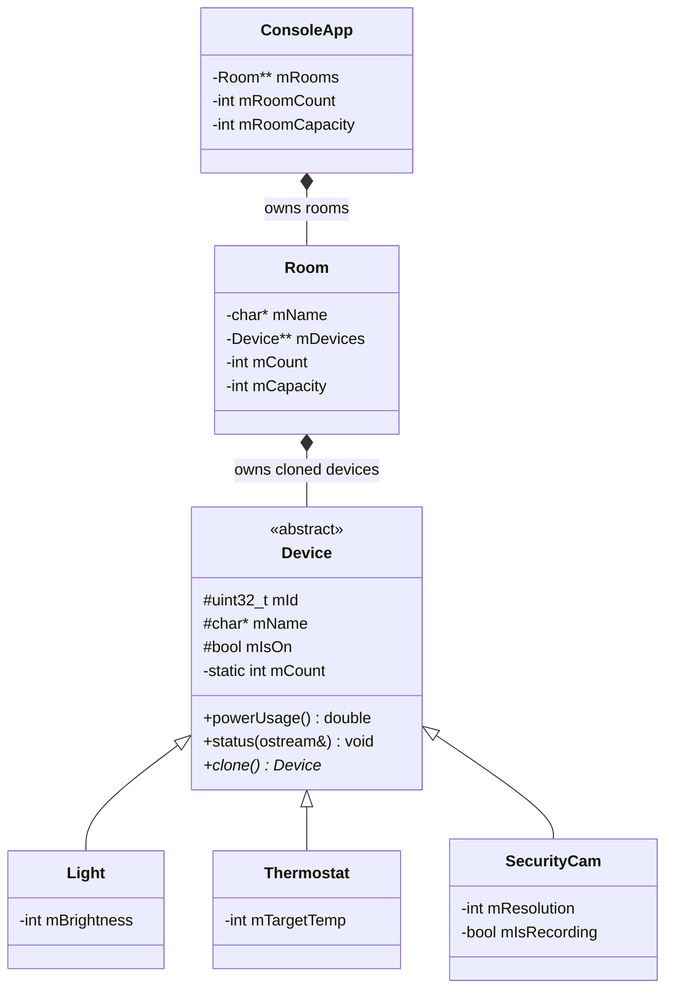

# Class diagram — Assignment 2

`Room` sở hữu bản clone của thiết bị; `ConsoleApp` sở hữu các phòng. Khi hoàn thiện assignment, xuất class diagram thành PNG/PDF để nộp cùng mã nguồn. Hiện đây chủ yếu là sơ đồ thiết kế; đã có implementation và test cho Device, Light, Thermostat và SecurityCam.
